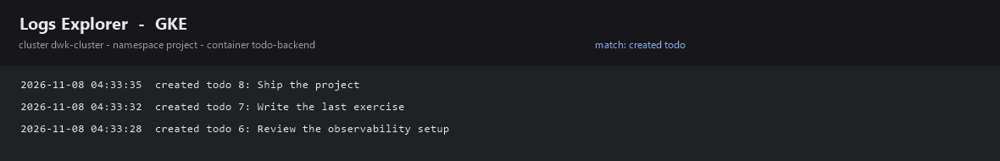

# project

The course project, deployed with Kustomize.

```
base/                 namespace, config, PostgreSQL, frontend, backend, generator, gateway
overlays/gke/         the overlay the pipeline applies to the cluster
```

## Deploy by hand

```bash
kubectl apply -k project/overlays/gke
kubectl get gateway,pods -n project
```

The GitHub Actions workflow `.github/workflows/deploy.yml` does the same for every push: it
builds the three images, pushes them to Artifact Registry tagged with the commit SHA, and applies
this overlay. `main` goes to the `project` namespace, any other branch goes to a namespace named
after the branch, and `.github/workflows/cleanup.yml` removes that namespace when the branch is
deleted.

## 3.9 DBaaS vs DIY: PostgreSQL on Cloud SQL versus PostgreSQL in the cluster
The two solutions we compared are the self-hosted PostgreSQL that the project runs today (a
StatefulSet with a `volumeClaimTemplate`) and Cloud SQL for PostgreSQL.

### Required work to initialise

| Aspect | Self-hosted StatefulSet | Cloud SQL |
| --- | --- | --- |
| Setup | One manifest with a Secret, a ConfigMap, a headless Service and a StatefulSet, applied in seconds | Create the instance, wait several minutes for provisioning, create the database and the user, configure the connection |
| Configuration surface | Everything is ours: image version, `postgresql.conf`, extensions, authentication | Limited to what the service exposes (flags, database flags, extensions allow-list) |
| Networking | Reached through a Service name inside the cluster, no extra component | Private IP needs a VPC peering and a private services access connection; public IP needs authorised networks |
| Initial credential handling | A Kubernetes Secret that we generate | Managed user passwords or IAM database authentication |

### Cost

| | Self-hosted | Cloud SQL |
| --- | --- | --- |
| Idle cost | A container on nodes we already pay for, roughly nothing extra | Pay per hour for the instance even when it is idle, plus storage and backups |
| Scaling | Vertical by resizing requests/limits, horizontal requires a replication setup we write ourselves | Vertical by changing the tier, read replicas available with one flag |
| Free tier for this course | Included in the GKE nodes | Consumes the $300 credit quickly if left running |

### Maintenance

| Aspect | Self-hosted | Cloud SQL |
| --- | --- | --- |
| Patching | We choose when to bump the image tag, and we own the compatibility testing | Automated maintenance windows, Google applies the patches |
| Failure recovery | Kubernetes restarts the container, but a corrupted volume or a split-brain is our problem | Automated failover to a standby with high availability enabled |
| Monitoring | Ours: probes, `pg_stat_*` metrics, our own alerts | Built-in metrics, query insights, alerting integrated with Cloud Monitoring |
| Operational knowledge | Requires understanding of PostgreSQL internals | Requires understanding of the managed service limits |

### Backups

| Aspect | Self-hosted | Cloud SQL |
| --- | --- | --- |
| Mechanism | We schedule `pg_dump` ourselves (that is exercise 3.10) and we must ship the file somewhere | Automated daily backups plus point-in-time recovery with the write-ahead log |
| Effort | A CronJob, a service account with bucket permissions and a retention policy we invent | A checkbox and a retention setting |
| Restore | Manual: download the dump and run `psql` | A console or `gcloud sql backups restore` command |

### Conclusion for this project

For the course the self-hosted StatefulSet wins: it is free, it lives in the same overlay as the
rest of the application and it makes the deployment pipeline self-contained. In a production
system with real data the trade flips: backups, point-in-time recovery and failover are precisely
the parts nobody wants to write by hand, and Cloud SQL costs less than the engineering time of
maintaining them.

## 3.12 Finding the project logs in GKE

GKE ships container stdout and stderr to Cloud Logging automatically, so no agent has to be
installed. The backend writes one line per created todo:

```
created todo 8: Ship the project
```

### From the console

1. Kubernetes Engine -> Workloads -> `project` namespace -> `todo-backend-dep`.
2. Open the **Logs** tab of the workload. It runs the query below for you.
3. Or open **Logging -> Logs Explorer** and paste the query.

### Query

```
resource.type="k8s_container"
resource.labels.namespace_name="project"
resource.labels.container_name="todo-backend"
textPayload:"created todo"
```

### From the command line

```bash
gcloud logging read 'resource.type="k8s_container" AND resource.labels.namespace_name="project" AND resource.labels.container_name="todo-backend" AND textPayload:"created todo"' \
  --limit 10 --format="value(timestamp,textPayload)"
```

### Captured evidence

`logs/todo-created.png` is rendered from the real Cloud Logging entries by
`scripts/gke-log-screenshot.ps1`, and `logs/todo-created.log` holds the same lines as text:


